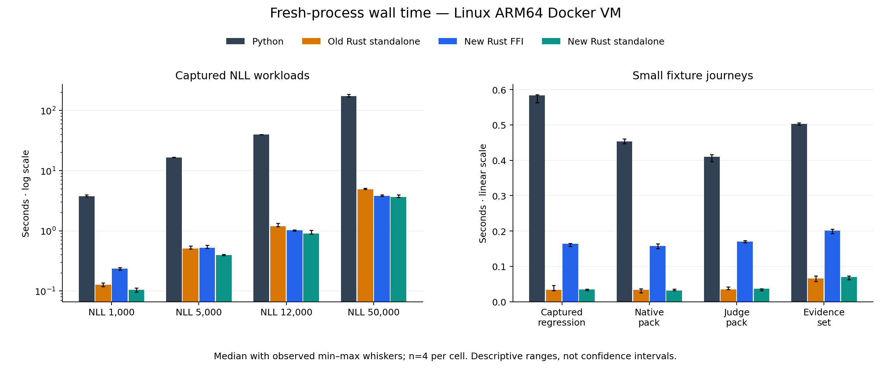
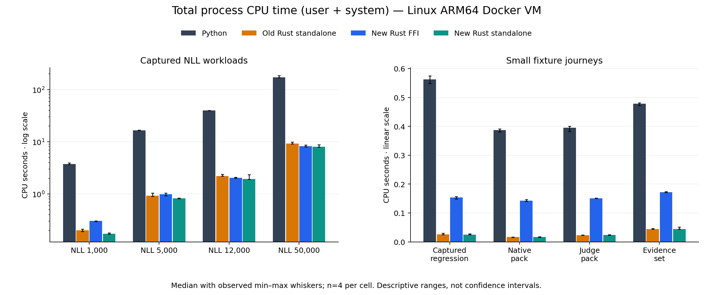
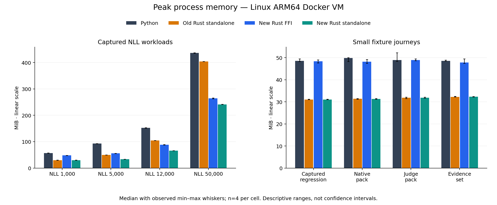

# Rust compact-record results

> **Measurement correction:** Later controls showed that the historical process
> launcher inherited its Python parent’s peak-memory floor and rounded short
> elapsed observations through a 10 ms polling loop. Small-workload RSS plateaus
> and tiny elapsed differences on this page cannot establish implementation
> gains or regressions. The retained observations remain unchanged. Revised
> measurements use a separate process boundary and are not pooled with these
> results. Whole-wheel identity reads also inflated small FFI peaks. See the
> [revised comparison](rust-small-workload-results.md) for the corrected method.

> **Reference**
>
> **Surface:** Compact Rust ownership and complete Linux transactions
>
> **Stability:** Experimental; Python remains the default backend
>
> **Use this page when:** Assessing the current Rust candidate's resource use and compatibility

The compact Rust layout improved the already optimized standalone Rust on the
four NLL workloads: median elapsed time fell **18–26%**, total CPU fell **11–14%**,
and peak RSS fell **32–40% at 5,000–50,000 records**. At 50,000 records, standalone
used **3.650 elapsed seconds, 7.997 CPU seconds and 241.465 MiB**, compared with
**4.913 seconds, 9.311 CPU seconds and 403.996 MiB** for prior Rust.

The changes did not improve every small workflow. Captured regression, judge
pack and evidence set elapsed medians rose **3.7%, 3.9% and 6.8%** versus prior
Rust; their observed ranges overlap. These are measured tradeoffs, not evidence
that further optimization is exhausted. The [earlier optimization report](rust-optimization-results.md)
and [macOS comparison](rust-expanded-results.md) remain unchanged historical results.

## Sources and environment

The fixed Python reference is `ce04f20ed7ccefc1bc826098f1b0aa4102b63ef3`.
The remote `staging/next` tip was checked after the run and still matched it.
Prior Rust is `088bf57ccc70ec9e48efb076ce41aeee7bd8d31e`; compact Rust FFI and
standalone use `673d492dde9d7b320c6f082a5ca2a8191ab37f66`, native tree
`c02d32bf2c75e38f2b27b326d1dbada4f412ffa8`. Both Rust sources were rebuilt on
the measured Linux architecture. No historical measurements are pooled here.

The run completed on 27 October 2026 UTC in native ARM64 Linux under Docker
Desktop on an Apple M2 Max, macOS 27, with 64 GiB host RAM. The VM reported eight
CPUs and approximately 16.48 GB RAM; the container was limited to four CPUs and
12 GiB. Its platform was Linux 7.0.14 with glibc 2.41. Inputs and outputs used a
Docker named volume on a Linux ext filesystem backed by the internal APFS
virtual disk. No TB4 host bind mount took part in measured I/O. CPython was
3.12.15, Rust 1.94.0 and Maturin 1.12.0. Installation and execution were offline.

Each journey executes its complete verification/report steps and retains the
outputs. Processes are fresh; filesystem caches are warmed by qualification.
Each cell has four observations with balanced candidate order and seed 4127.
Charts show observed minimum and maximum, not confidence intervals. The protocol
allows 300 seconds per process and a 7,200-second dispatch admission budget;
that budget is not a hard elapsed-time cap. Builds, tests and profiling stopped
during the timing matrix.

Standalone calls native transaction entry points; FFI calls native transactions
from an installed Python interpreter. These paths do not measure every public
CLI command or Python adapter layer.

## Complete-process elapsed time

Median elapsed seconds, including startup and output publication. Lower is better.

| Workload | Python | Prior Rust standalone | Compact Rust FFI | Compact Rust standalone |
| --- | ---: | ---: | ---: | ---: |
| NLL 1,000 | 3.779 | 0.128 | 0.235 | 0.104 |
| NLL 5,000 | 16.659 | 0.510 | 0.525 | 0.397 |
| NLL 12,000 | 39.863 | 1.190 | 1.016 | 0.901 |
| NLL 50,000 | 172.527 | 4.913 | 3.836 | 3.650 |
| Captured regression (64) | 0.584 | 0.033 | 0.164 | 0.034 |
| Native pack | 0.453 | 0.034 | 0.157 | 0.032 |
| Judge pack | 0.410 | 0.035 | 0.170 | 0.036 |
| Evidence set | 0.503 | 0.066 | 0.202 | 0.070 |

All four NLL standalone improvements versus prior Rust have separate observed
ranges. The small native pack median fell 5.2%, while the other three small
medians rose as stated above; all four small-workflow ranges overlap.

## Total CPU time

Median user-plus-system CPU seconds per complete process. User and system CPU
are summed within each attempt before computing the median. Parallel work can
reduce elapsed time without reducing CPU consumption, so both dimensions matter.

| Workload | Python | Prior Rust standalone | Compact Rust FFI | Compact Rust standalone |
| --- | ---: | ---: | ---: | ---: |
| NLL 1,000 | 3.756 | 0.200 | 0.305 | 0.173 |
| NLL 5,000 | 16.643 | 0.932 | 0.984 | 0.827 |
| NLL 12,000 | 39.843 | 2.208 | 2.036 | 1.930 |
| NLL 50,000 | 172.489 | 9.311 | 8.248 | 7.997 |
| Captured regression (64) | 0.563 | 0.026 | 0.154 | 0.025 |
| Native pack | 0.387 | 0.016 | 0.143 | 0.016 |
| Judge pack | 0.395 | 0.023 | 0.151 | 0.024 |
| Evidence set | 0.478 | 0.045 | 0.172 | 0.045 |

Versus prior standalone Rust, six CPU medians fell and two rose. The judge and
evidence set increases were 2.9% and 0.2%; their ranges overlap. The NLL reductions
were 11.3–14.1%; the 12,000-record CPU ranges overlap, while the other three do not.

## Peak resident memory

Median complete-process peak RSS in MiB from Linux `wait4`. FFI includes Python
process overhead. RSS is not GPU or container-wide memory. Tables round values;
comparisons use the retained unrounded medians.

| Workload | Python | Prior Rust standalone | Compact Rust FFI | Compact Rust standalone |
| --- | ---: | ---: | ---: | ---: |
| NLL 1,000 | 56.656 | 30.070 | 48.404 | 30.070 |
| NLL 5,000 | 92.752 | 49.799 | 55.670 | 33.768 |
| NLL 12,000 | 152.734 | 104.648 | 88.209 | 66.023 |
| NLL 50,000 | 436.164 | 403.996 | 264.189 | 241.465 |
| Captured regression (64) | 48.531 | 31.070 | 48.342 | 31.070 |
| Native pack | 49.820 | 31.383 | 48.158 | 31.320 |
| Judge pack | 48.920 | 31.883 | 48.912 | 31.820 |
| Evidence set | 48.504 | 32.258 | 47.846 | 32.320 |

Versus prior standalone Rust, five RSS medians fell, two tied and one rose.
The evidence set median rose 0.194%, with overlapping ranges. The small-workflow
RSS ranges overlap, as do those for NLL 1,000. The 5,000–50,000-record reductions
have separate ranges.

Both Rust paths had lower observed medians than Python in all eight workloads
for elapsed time, total CPU and RSS: 24 comparisons per path. Standalone's ranges
were separate in all 24. FFI's RSS ranges overlap Python in all four small
workflows; the judge median difference is only **8 KiB**. Those small FFI memory
differences do not establish a convincing advantage across all metrics and inputs.
At 50,000 records, Python used 172.527 elapsed seconds, 172.489 CPU seconds and
436.164 MiB in this same matrix.

## Implementation and diagnostic evidence

The parser consumes captured runs one row at a time into contiguous owned
records and compact likelihood fields. Known field names no longer require a
JSON object map per row or likelihood object. Open values, metadata, scores and
numbers retain their `Value` representation and numerical semantics. Immutable
borrowed run, record and likelihood views serve verification and reporting.
Sorted borrowed records preserve lexical case order; packed scope masks reuse
predicate results without copied pair arrays. Production reporting projects its
view and required shared-input facts without rebuilding both JSON runs. Missing
result previews copy only the displayed IDs, preserving complete missing-result
counts and decisions.

Canonical comparisons, hashes and case-set projections stream their existing
bytes. Raw payloads are released after decoding while a source guard retains
final pinned inventory checks. Public `Value` compatibility helpers can still
materialize ordinary JSON. When a compact attempt fails, encounters an unsupported shape or finds input
that does not use canonical JSON, it is discarded; the original bytes
are parsed again by the strict generic Rust path. Deferred checks retain the
established error stages. Rejected inputs can therefore incur additional CPU work.

Both candidates already contain bounded bootstrap workers, scratch reuse and
runtime ARM SHA acceleration. This comparison measures the additional compact
ownership and consumer changes together, not a new statistical method or an
isolated language effect. The two locally patched schema/JSON dependencies add
maintenance obligations documented with their upstream licenses and exact patches.

A separate macOS allocator probe for the 50,000-record journey measured requested
peak allocations falling from 318,245,476 to 199,856,042 bytes during verification,
and from 319,485,165 to 200,708,546 during reporting: about **37%** in each phase.
Allocation calls fell about **26%** and **23%**, respectively. Receipt verification
peak requested bytes rose slightly, with unchanged allocation count. These are
instrumented allocator observations, separate from Linux RSS and comparative
timing; cumulative allocation traffic is not retained live memory.

A separate fixed-48-byte SHA-256 prototype matched its exercised digest and draw
checks. Six paired 50,000-record kernel observations showed about **1.3%** median
paired kernel improvement, without complete-transaction evidence. That prototype
was left out; the candidate retains the simpler general digest implementation.
The isolated kernel result is not counted as an end-to-end speedup.

## Qualification and retained evidence

**32 of 32 qualifications and 128 of 128 timed attempts passed**, with no retries,
exclusions or missing cells. Each candidate matched the reference result and
output-file hashes, apart from explicitly declared report destination paths.

The frozen host release workspace passed 132 tests and ignored one explicit
timing diagnostic. The Linux release workspace passed 133 tests with the same
one ignored diagnostic. The installed candidate wheel with source Python adapters
passed 428 ordinary cases and 16,448 numerical subtests; one file-name case was
skipped because the host filesystem rejected the non-UTF-8 name. Formatting and
Clippy passed, and source-archive packaging was checked. These checks cover their
exercised fixtures, not every input or live provider behavior.

The repository verification run initially stopped on documentation spelling;
the corrected documentation passed its full gate and strict build. The separate
full examples run failed two unchanged Python process-cleanup cases on macOS
with permission errors. Seven focused cases passed a serial diagnostic rerun,
and all 43 cases in the two affected modules passed with the original two-worker
configuration. The original failures remain retained: these reruns do not
establish a clean full examples run or resolve the intermittent cleanup failure.
They are separate from the successful native and Linux comparison checks above.

Additional compact/generic checks cover canonical bytes, binary64 results,
original semantic-error order, lexical pairing, large exact counts, overlapping
scope budgets, missing IDs and schema rejection. Missing-heavy reporting and
overlapping slices have targeted fixtures; the eight timed workloads do not
establish performance or capacity for those additional shapes. Earlier diagnostic
failures and separate kernel experiments remain retained outside the 160 comparison attempts.

The public results are in
`experiments/rust/results/compact-linux-arm64-py312.json`, including source and
artifact identities, every sample's metrics and output hashes. The renderer
rechecks retained inputs, requests, outputs and all 160 attempts before generating
the tables and three PNG/SVG chart pairs. All **2,901** files in the complete
retained export matched their hashes; its archive was separately verified with
SHA-256 `effc6f3810915fe8c49069cc54f29c732c17285e2004117b2edf787b8c124959`.
Fixture keys are synthetic and excluded from the public results.

## Deployment limits

These observations support the compact Rust layout for the measured Linux
evidence workflows and show improvements beyond the previous optimized Rust
build. They do not establish a universal optimum. Production x86, bare-metal
Linux, cold caches, large native/judge packs, live providers, GPUs and customer
installation experience remain unqualified. Requested allocator bytes, isolated
kernel timings and fixture conformance cannot substitute for those checks.
Python remains the default backend while deployment evidence is gathered.
