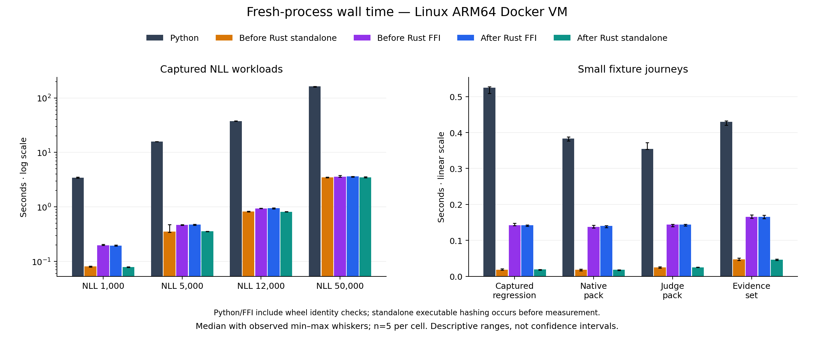
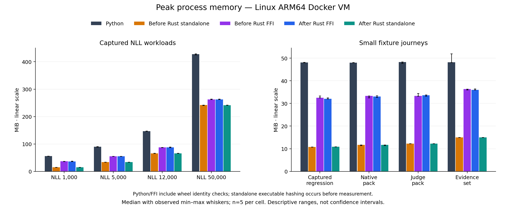
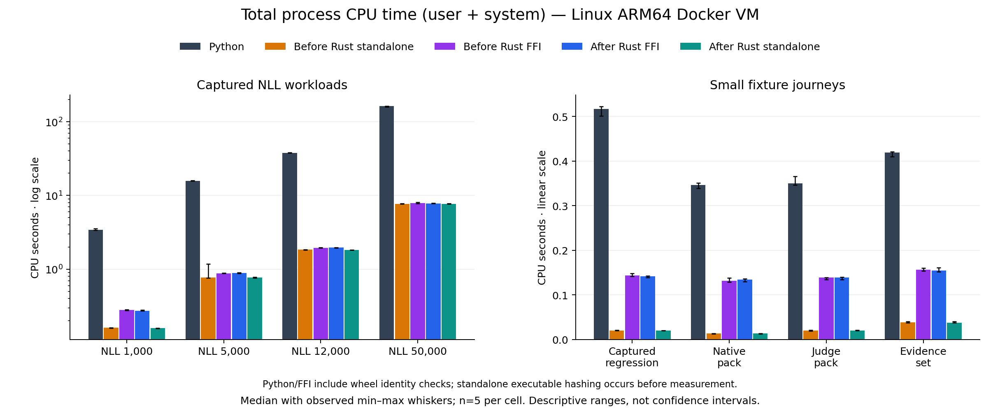
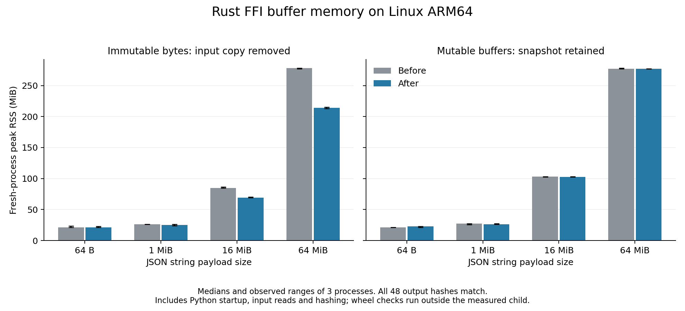

# Rust FFI and corrected-reference results

> **Reference**
>
> **Surface:** Rust byte-buffer ownership and comparison with corrected Python
>
> **Stability:** Experimental; Python remains the default backend
>
> **Use this page when:** Assessing this optimization's measured gains, regressions and output parity

Borrowing immutable Python bytes removed one input-sized native allocation. A
64 MiB JSON payload reduced peak process RSS from **278.332 to 214.324 MiB**,
about **23.0%**. This is a direct buffer diagnostic; the retained workflows mostly
pass file paths and do not receive that same memory reduction.

Whole-workflow results remain mixed against the preceding Rust revision. Some
elapsed and CPU medians improved, while others regressed slightly. The native-pack
FFI elapsed median increased **1.61%**, and its CPU median increased **2.47%**.
This revision does **not** eliminate every remaining Rust regression.

Both final Rust paths have lower elapsed-time, total-CPU and peak-RSS medians than
the corrected Python reference on all eight workloads: **24 of 24 metric cells
per path**. These are measurements of the configured experiment, including the
identity-check asymmetry described below, not universal language-performance claims.

All **40 qualification and 200 timed outcomes** matched the corrected Python
results, including statuses, signed receipts and report-file hashes. Only declared
report destination paths are normalized. There were **zero retries and zero
exclusions**. The separate buffer diagnostic also matched all **48 output hashes**.

## Corrected reference and implementation

The reference is Python **0.17.3** at staging revision
`1dc9cb644684dc915810da77326f6da8764c58c1`, after
[the numeric-range fixes were merged](https://github.com/invarlock/invarlock/pull/301).
Its wheel was built from that exact source archive and installed in both comparison
environments. It contains the ordinary Python implementation, separately from the
experimental backend adapters.

Measured native revisions:

- Before: `b45f3fe172f8dd7fd5271c0b7e16f488442afed9`.
- After: `8828655dddf17e8f118b876c657941d6dd22d6e3`.

Immutable JSON request `bytes` inputs now remain borrowed while the Python GIL is released;
the Python argument retains ownership throughout the call. Mutable buffers and
sequences retain owned snapshots. This removes a copy without adding unsafe Rust
or changing accepted input types.

The fixed 48-byte SHA-256 draw protocol uses precomputed padding and the existing
`sha2` compression implementation. Hash rounds, digest bytes, sample order and
floating-point evaluation order remain unchanged. The bounded Linux draw diagnostic
showed only about **0.5–0.8%** lower medians; it is not evidence of a large workflow
speedup. Independent high-level SHA-256 checks cover varied seeds, counts and
counter boundaries.

Rust also normalizes the corrected finite-range failures and includes the new
empty report-view link field. Client handoff packaging remains Python-only:
`report --package --backend rust` fails explicitly before creating a package.
That newly added packaging feature is outside this performance matrix.

## Full-workflow elapsed time

Seconds; medians of five fresh processes per cell.

| Workload | Python | Rust FFI | Rust standalone |
| --- | ---: | ---: | ---: |
| NLL 1,000 | 3.415 | 0.194 | 0.079 |
| NLL 5,000 | 15.855 | 0.473 | 0.356 |
| NLL 12,000 | 37.677 | 0.947 | 0.815 |
| NLL 50,000 | 162.670 | 3.613 | 3.486 |
| Captured regression | 0.524 | 0.142 | 0.019 |
| Native pack | 0.383 | 0.140 | 0.018 |
| Judge pack | 0.355 | 0.144 | 0.025 |
| Evidence set | 0.430 | 0.165 | 0.046 |

## Full-workflow peak memory

MiB; unadjusted operating-system peak RSS. The largest workload uses 427.766 MiB
for Python, 262.617 MiB for Rust FFI and 241.539 MiB for standalone Rust.

| Workload | Python | Rust FFI | Rust standalone |
| --- | ---: | ---: | ---: |
| NLL 1,000 | 55.672 | 36.133 | 15.090 |
| NLL 5,000 | 89.688 | 55.137 | 33.625 |
| NLL 12,000 | 146.945 | 87.625 | 65.918 |
| NLL 50,000 | 427.766 | 262.617 | 241.539 |
| Captured regression | 48.098 | 32.035 | 10.898 |
| Native pack | 48.055 | 33.105 | 11.680 |
| Judge pack | 48.320 | 33.648 | 12.250 |
| Evidence set | 48.234 | 36.027 | 15.004 |

## CPU and remaining regressions

Total CPU is user plus system CPU computed for each observation before taking
the median. At 50,000 pairs, it is **162.651 s** for Python, **7.814 s** for Rust
FFI and **7.694 s** for standalone Rust.

Changes relative to the preceding Rust revision; negative values mean lower
resource use or elapsed time. RSS increases remain visible even when small.

| Workload | Standalone time | FFI time | Standalone CPU | FFI CPU | Standalone RSS | FFI RSS |
| --- | ---: | ---: | ---: | ---: | ---: | ---: |
| NLL 1,000 | -1.87% | -2.34% | -1.01% | -1.46% | +0.86% | -1.30% |
| NLL 5,000 | +0.60% | +1.55% | -0.05% | +0.50% | +0.40% | -0.04% |
| NLL 12,000 | -1.21% | +0.87% | -0.82% | +0.11% | +0.24% | +0.20% |
| NLL 50,000 | +0.31% | +1.06% | -0.29% | -0.29% | -0.22% | -0.04% |
| Captured regression | +1.55% | -0.07% | -0.40% | -1.34% | +1.16% | -1.54% |
| Native pack | +1.39% | +1.61% | +1.68% | +2.47% | +0.03% | -0.71% |
| Judge pack | -0.10% | +0.02% | +0.04% | +0.35% | +0.10% | +0.94% |
| Evidence set | -1.27% | +0.01% | -2.47% | -1.15% | -0.03% | -0.86% |

The before/after elapsed ranges overlap in **16 of 16** workflow/path
comparisons. These ranges are descriptive observations, not confidence intervals.
Five observations do not establish population significance or tail latency.
The largest-workload elapsed medians rose slightly while total CPU fell slightly;
this is not an all-metric improvement.

## Direct buffer diagnostic

Three fresh processes per size, input type and native revision. Each 64-byte
process performs 1,000 calls; its per-call median is based on three process
observations, not 3,000 independent samples. Larger cases perform one call.

| Immutable payload | Peak MiB before | Peak MiB after | Native call ms before → after |
| --- | ---: | ---: | ---: |
| 64 B | 21.309 | 21.438 | 0.000409 → 0.000399 |
| 1 MiB | 26.367 | 25.371 | 2.342291 → 1.858250 |
| 16 MiB | 84.957 | 69.113 | 21.115959 → 19.688958 |
| 64 MiB | 278.332 | 214.324 | 78.359167 → 76.651001 |

The 64 MiB mutable-buffer control stayed approximately level: **276.957 →
277.070 MiB**. The immutable 64-byte process peak increased slightly, **21.309 →
21.438 MiB**. Borrowing therefore demonstrates a large-input memory saving, not a
universal reduction in process high-water memory.

This diagnostic measures fresh-process input reading, native canonicalization,
output hashing and native-module hashing. Installed-wheel checks happen before
launching the measured child. The separate operation timer covers native calls.
It is a different process boundary from the full-workflow experiment and is not
pooled with those measurements.

## Measurement and validation

The run used Linux ARM64 in a Docker VM on an Apple M2 Max host, CPython 3.12.15
and Rust 1.94.0. The container had a four-CPU quota and a 12 GiB memory limit;
fixtures and outputs used a Linux ext filesystem. No host bind mount was in the
measured data path. This is not an x86 Linux or production-server performance claim.

The unchanged five-candidate protocol used eight workloads, five balanced rounds,
seed 4127 and a 300-second per-sample timeout. Forty qualification cases completed
before timed rounds began. The whole run took about **24 minutes 16 seconds**.
No owned builds or tests ran during timing.

The fresh-exec C supervisor records monotonic elapsed time and unadjusted child
CPU/RSS. It measures the actual worker and its threads; it does not aggregate
arbitrary descendant processes. Python and FFI workers include streamed checks
of both installed wheels, including the unused native wheel on the Python path.
Standalone executable hashing happens before measurement. Thus cross-language
process ratios include asymmetric measurement work. Before/after comparisons
within each path share the same boundary; no measured time or memory is subtracted.

Qualification included:

- Linux: 135 Rust tests and three doctests passed. Two timing diagnostics are
  excluded from ordinary tests; the fixed-block diagnostic was run separately.
- The installed Linux extension passed six numerical differential tests and
  matched six corrected overflow refusals, five finite report controls and four
  byte-input types against the installed Python reference.
- Four additional public CLI regression checks matched exit codes and JSON error
  payloads across Python and Rust, with no evidence published on either path.
- The macOS installed wheel and release binaries passed 449 native integration
  tests and 16,448 subtests. One test was skipped because that host filesystem
  rejects non-UTF-8 filenames. Clippy and Rust/Python formatting checks passed.
- Every retained Linux export file was independently rehashed after extraction:
  **3,940 files** matched, with no unexpected files. The result renderer separately
  validated all 240 comparison records and their retained output-file identities.

Earlier qualification failures remain retained. A missing report-view field and
stale installed Python version metadata were repaired, then the full native suite
passed. An erroneous final command in the first Linux test launcher failed after
its Rust tests completed; the actual installed-Python checks were run explicitly
and passed. Repository verification also found missing registrations and a reader
contract in existing Rust documentation; the repaired documentation checks passed.
None of these attempts was a timed benchmark retry.

These are synthetic, retained offline workflows. They demonstrate implementation
behavior and resource use for the exercised cases, not real-model quality, live
provider behavior or exhaustive arithmetic equivalence. See the
[Python reference audit](rust-reference-audit.md) for independent checks and limits.

## Retained data

The public summaries retain per-sample metrics, source and artifact identities,
observed ranges and the measurement qualifications:

- [Full workflow results](https://github.com/invarlock/invarlock/blob/work/rust-evidence-core/experiments/rust/results/ffi-linux-arm64-py312.json).
- [Buffer diagnostic results](https://github.com/invarlock/invarlock/blob/work/rust-evidence-core/experiments/rust/results/ffi-buffer-linux-arm64-py312.json).

The retained Linux archive SHA-256 is
`c6c3ca03085604cb4260b8c1179fe85e3d950ca07e6b04888c1b26105e588f93`.
The archive contains raw samples, output files, fixtures, source archives, built
artifacts, qualification logs and the export hash manifest; build caches and
installed virtual environments are excluded.
