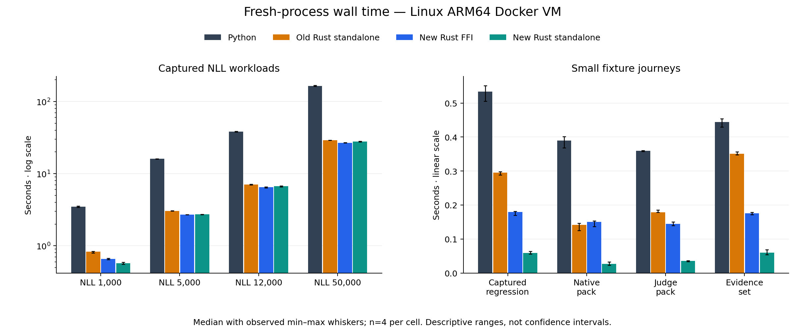
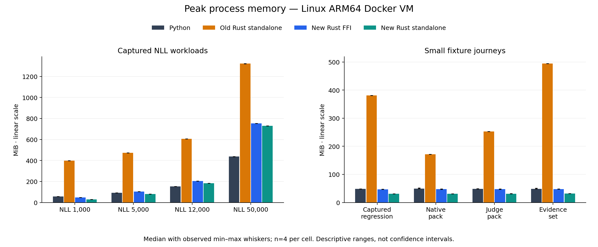

# Rust optimization results

> **Reference**
>
> **Surface:** Experimental native memory changes and Linux comparison
>
> **Stability:** Experimental; Python remains the default backend
>
> **Use this page when:** Assessing resource use before selecting the Rust backend

These measurements describe the earlier `5e4c0c53` candidate. The subsequent
[compact Rust results](rust-compact-results.md) measure further layout changes
against an already optimized Rust build.

The optimized standalone Rust candidate used **44.7–93.6% less peak memory**
than the previous Rust build in these eight Linux fixture workflows. It was
**5.72–14.31 times as fast as Python** by median complete-process elapsed time.
Memory remains a tradeoff for large captured inputs: at 50,000 records Rust used
**730.7 MiB versus Python's 436.8 MiB**, while finishing in **28.0 seconds versus
164.0 seconds**. This does not establish a universal Rust memory advantage.

Linux is the primary deployment and performance target. Keep validation,
canonical hashing, numerical analysis and reporting portable, with Linux-specific
process and filesystem operations at the operating-system boundary. macOS remains
useful for development and regression checks. The original
[expanded macOS comparison](rust-expanded-results.md) is retained separately;
its results are not pooled with this run.

## Environment and comparison

The run completed on 27 October 2026 UTC in a native Linux ARM64 Docker Desktop
virtual machine on an Apple M2 Max, macOS 27, with 64 GiB physical RAM. The VM
reported eight CPUs and about 16.48 GB RAM; the container was limited to four
CPUs and 12 GiB. Inputs and outputs used a Linux ext filesystem on a named
volume backed by the internal APFS virtual disk. No TB4 host bind mount took
part in measured I/O. This is ARM64 VM evidence, not production x86 or bare-metal
evidence.

All candidates used the same fixed fixtures, storage and resource limits.
Builds and other test work stopped during measurement. Python was CPython
3.12.15; both native versions were release builds with Rust 1.94.0. The binding
wheel used Maturin 1.12.0. Package installation and comparison execution were
offline.

| Candidate | Measured path | Source revision |
| --- | --- | --- |
| Python | Installed reference wheel, public workflow functions | `ce04f20ed7ccefc1bc826098f1b0aa4102b63ef3` |
| Previous Rust standalone | Native transaction runner | `09e23090cba31666ca083d38acd15343da6096be` |
| Optimized Rust FFI | Installed Python interpreter calling native bindings | `5e4c0c53ac2fe593880fda713b3c57f9d3d12478` |
| Optimized Rust standalone | Native transaction runner | `5e4c0c53ac2fe593880fda713b3c57f9d3d12478` |

The `staging/next` tip was checked again after measurement and remained the
Python reference revision above.

Each journey executes the fixture's complete verification/report steps and
retains generated files. The standalone runner calls native library entry
points; it is not a measurement of every user-facing CLI command. The FFI path
calls native transactions directly, so it does not measure every Python adapter
or CLI layer. An old Rust FFI candidate was not included; the same-platform
before/after control is standalone Rust.

**32 of 32 qualifications and 128 of 128 timed attempts passed.** Every candidate
matched the Python result and output-file hashes, apart from declared report
destination paths. There were no timed-run retries, exclusions or missing cells.
The eight workloads each have four measurements per candidate, with balanced
candidate order and seed 4127. Processes were fresh; filesystem caches were
warmed by qualification. The fixed protocol allowed 300 seconds per process and
a 7,200-second dispatch-admission budget, which is not a hard wall-clock cap.

## Elapsed time

Median complete-process elapsed seconds, including process startup and output
publication. Lower is better. Four observations per cell; charts show the
observed minimum and maximum, not confidence intervals.

| Workload | Python | Previous Rust standalone | Optimized Rust FFI | Optimized Rust standalone |
| --- | ---: | ---: | ---: | ---: |
| NLL 1,000 | 3.492 | 0.826 | 0.658 | 0.574 |
| NLL 5,000 | 16.017 | 3.045 | 2.703 | 2.726 |
| NLL 12,000 | 38.194 | 7.057 | 6.470 | 6.674 |
| NLL 50,000 | 164.037 | 29.019 | 26.865 | 28.003 |
| Captured regression (64) | 0.534 | 0.295 | 0.180 | 0.059 |
| Native pack | 0.389 | 0.141 | 0.150 | 0.027 |
| Judge pack | 0.359 | 0.179 | 0.145 | 0.035 |
| Evidence set | 0.444 | 0.351 | 0.175 | 0.060 |

The optimization reduced standalone elapsed time by about 3.5–30.5% on the NLL
sizes and 79.9–82.8% on the four small workflows, compared with previous Rust on
the same Linux host. The largest case's main new benefit is memory: its elapsed
time changed from 29.02 to 28.00 seconds. Most of its speed advantage over Python
already existed in the earlier Rust implementation. The optimized FFI path was
slightly faster than standalone on the larger NLL cases; standalone had much
lower complete-process time on the small workflows.

## Peak memory

Median process peak resident set size in MiB, measured using Linux `wait4`
resource usage. This includes interpreter/native process overhead. It is not
retained allocator bytes, container-wide memory or GPU memory.

| Workload | Python | Previous Rust standalone | Optimized Rust FFI | Optimized Rust standalone |
| --- | ---: | ---: | ---: | ---: |
| NLL 1,000 | 56.5 | 398.5 | 48.0 | 29.6 |
| NLL 5,000 | 92.8 | 473.8 | 103.4 | 81.6 |
| NLL 12,000 | 152.2 | 605.5 | 204.0 | 182.6 |
| NLL 50,000 | 436.8 | 1321.5 | 753.2 | 730.7 |
| Captured regression (64) | 48.3 | 380.9 | 47.0 | 31.4 |
| Native pack | 49.8 | 171.2 | 47.8 | 31.4 |
| Judge pack | 48.3 | 252.7 | 47.4 | 31.4 |
| Evidence set | 48.6 | 494.3 | 48.0 | 31.9 |

Standalone Rust used less memory than Python in six of eight fixture workflows.
At 12,000 records it used about 20% more; at 50,000 it used about 67% more. FFI
retains Python process overhead and exceeded Python's RSS in the three largest
NLL sizes. Removing the large schema-cache cost therefore resolves much of the
small-workload regression, but does not eliminate size-dependent JSON storage.
Further large-input work should target bounded parsing and compact typed record
storage, with the same ordering, diagnostic and snapshot guarantees tested.

## Implemented changes

Schema compilation now shares referenced validators. A documented two-file
patch to vendored `jsonschema` 0.39.0 preserves reference traversal in custom
keyword diagnostics: without the repair, shared validators selected the wrong
first public error. All 54 targeted reference cases and the complete 59-case
contracts differential suite pass after repair. Vendored code is third-party
dependency code, not newly converted InvarLock code. Its upstream provenance,
patch and removal criteria are retained in `native/vendor/jsonschema/`;
maintaining that small patch is an additional dependency cost.

The comparison seed streams borrowed fields into its canonical hash, preserving
exact bytes and numerical methods. Report assembly moves loaded evidence into
its result instead of copying both runs. Snapshot and source-identity checks
remain in place.

Publication retains each synchronization boundary and now uses the Python
reference's `fsync` contract. On macOS this replaces the stronger `F_FULLFSYNC`
operation previously used by Rust. Linux already used `fsync`; this change is
not a Linux speedup claim, and the former macOS power-loss durability guarantee
must not be inferred from these measurements.

Linux qualification exposed a lock-lifetime defect before the timing matrix:
closing the owner file could leave its lock held by a duplicated or inherited
descriptor. All four execution lock types now explicitly release owner-process
locks, retry interrupted unlocks and reject inherited mutation authority. The
failed qualification and original binaries were retained. Deterministic
descriptor-lifetime regressions and actual Linux executable-descriptor launch
passed before the repaired source was frozen for measurement.

## Correctness and retained evidence

The final Linux release workspace passed 69 tests, including 28 execution tests.
The execution suite exercises surviving duplicate descriptors, failed lock
contenders, constructor errors, inherited mutation rejection and actual Linux
executable-descriptor launch. It does not establish live provider or GPU behavior.

On macOS, the installed final native wheel with the source Python adapters passed
428 ordinary native test cases and 16,448 numerical subtests; one non-UTF-8
filename case was skipped because the filesystem rejected that filename. The
rebuilt final control executable then passed all 48 execution differential cases.
Clippy and Rust formatting checks passed. The archive tests verified inclusion
of the complete workspace and vendored dependency files. The final `make verify`
completed successfully, including repository, product, documentation and example
gates. Tests requiring absent optional evaluator SDKs were skipped; this is not
validation of those SDK or live-provider paths.

Earlier local check invocations and documentation failures remain in the evidence
logs. The Python source adapters require the documented `PYTHONPATH`; an initial
focused invocation used the installed reference package and failed imports before
being rerun with that documented configuration. Neither those checks nor the
failed Linux lock qualification before measurement are counted among the 160
comparison attempts.

The macOS allocator probe is diagnostic evidence, separate from the Linux RSS
results. First empty-input schema validation fell from about 128 to 6 MiB RSS;
eight schemas fell from about 212 to 8 MiB. Requested peak allocations for the
50,000-record report fell from about 1,095 to 571 MiB. Requested allocations do
not measure complete-process resident memory.

The public machine-readable results are retained at
`experiments/rust/results/optimized-linux-arm64-py312.json`, with every sample's
metrics, output hashes and artifact/source identities. The generator
`experiments/rust/render_optimization_results.py` rechecks the retained fixtures,
source bundle, artifacts, requests, outputs and all 160 samples, then recomputes
the tables from the four observations in every cell. The complete private export
contains 2,441 hashed files and has archive SHA-256
`f57dd43b3b46beee968da65a6598a0b8a08c275b4d10152399febc9e8bc52542`.
Fixture private keys are synthetic and are excluded from the public results.

## Deployment implication and limits

These observations support continuing with the Rust evidence core and making
Linux the primary qualification target. They support faster offline evidence
workflows and substantially lower Rust memory use; they do not justify claiming
that every workload uses less memory than Python or that every application
component should become Linux-specific.

Production x86, bare-metal Linux, cold caches, thermal stability, large native
and judge packs, live providers, GPUs and customer installation experience remain
unqualified. The next deployment check should use the intended Linux CPU
architecture and storage. Python remains the default backend while that rollout
evidence is gathered.
