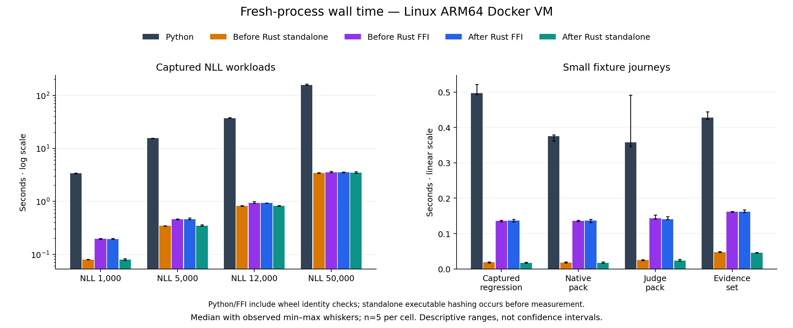
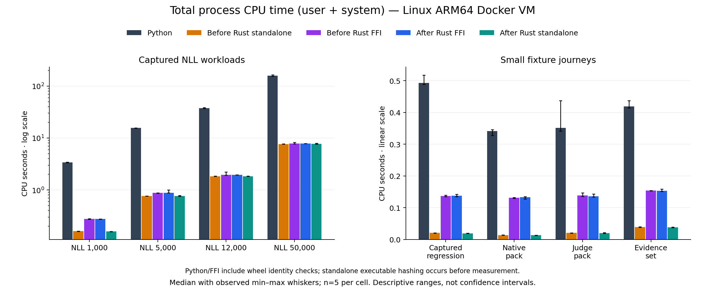
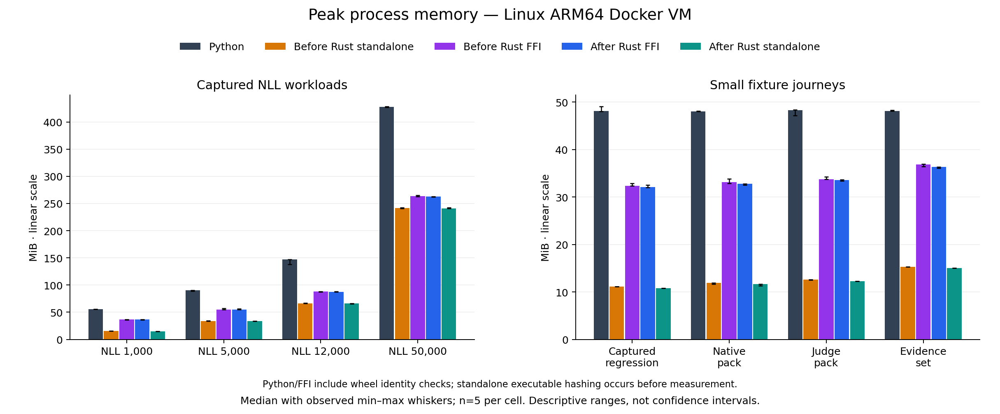

# Rust small-workload results

> **Reference**
>
> **Surface:** Small Rust transactions, extension memory and corrected Linux measurement
>
> **Stability:** Experimental; Python remains the default backend
>
> **Use this page when:** Comparing the schema optimization with its preceding Rust implementation

For the subsequent byte-buffer optimization and corrected Python reference, see
[Rust FFI results](rust-ffi-results.md).

The schema change reduced small standalone elapsed medians by **3.4–6.0%**,
total CPU by **4.0–6.1%**, and peak RSS by **1.8–3.0%**. These are modest gains:
roughly 1.0–1.6 ms per small journey. Larger NLL results are mixed, and FFI elapsed
changes range from a 2.06% reduction to a 0.47% increase. The change did not make
every Rust measurement better.

Both final Rust paths have lower elapsed, total-CPU and peak-RSS medians than
Python on all eight retained workloads: **24 of 24 metric cells per path**.
Those comparisons describe the configured experiment, including the identity-check
costs explained below. They are neither pure language ratios nor evidence of
optimal performance on every input or machine.

All **40 qualification and 200 timed outcomes** matched, including computed
results, statuses, receipts and report-file hashes. Only declared report destination
paths are normalized. There were **zero retries and zero exclusions**. A separate
raw-output review also matched every current result and output inventory against
the previous Python results and independently rehashed 1,088 output files.

## The Rust change

The embedded schemas are immutable definitions compiled into the binary. The new
path avoids repeating validation of those definitions against the JSON Schema
meta-schema. It retains ordinary instance validation and its error traversal.
All embedded definitions and both guarded run projections are validated normally
in tests. Caller-supplied definitions and dynamically selected fragments keep
normal definition checks.

Exploratory allocation instrumentation found approximately 8,855 fewer allocation
calls, 997 KB less cumulative requested memory and 329 KB less retained requested
memory per tested process. These are allocator-level macOS diagnostics, not Linux
RSS measurements. The final comparison below rebuilt both source revisions on
Linux and uses one measurement method for all candidates.

## Small standalone journeys

Medians of five observations. CPU is user plus system time computed per attempt
before taking the median. Peak memory uses MiB.

| Workload | Elapsed ms, before → after | CPU ms, before → after | Peak MiB, before → after |
| --- | ---: | ---: | ---: |
| Captured regression | 18.650 → 17.534 | 20.367 → 19.125 | 11.109 → 10.773 |
| Native pack | 18.433 → 17.432 | 13.716 → 12.920 | 11.891 → 11.676 |
| Judge pack | 25.001 → 23.796 | 20.396 → 19.571 | 12.570 → 12.242 |
| Evidence set | 47.511 → 45.886 | 39.324 → 37.663 | 15.309 → 15.008 |

All four small standalone workflows improved on the three reported medians.
Only the evidence-set elapsed ranges are disjoint; the other elapsed ranges
overlap. These descriptive observations do not establish population confidence
intervals or statistical significance.

## Small Python-extension journeys

| Workload | Elapsed ms, before → after | CPU ms, before → after | Peak MiB, before → after |
| --- | ---: | ---: | ---: |
| Captured regression | 136.217 → 136.653 | 137.045 → 137.568 | 32.316 → 32.098 |
| Native pack | 135.960 → 136.605 | 131.243 → 132.808 | 33.113 → 32.762 |
| Judge pack | 143.201 → 140.252 | 138.386 → 135.289 | 33.758 → 33.527 |
| Evidence set | 161.707 → 161.686 | 153.562 → 153.341 | 36.812 → 36.336 |

FFI elapsed medians improve for judge and evidence-set workflows and increase
slightly for captured regression and native pack. All before/after FFI elapsed
ranges overlap. There are no exact median ties; some differences round to zero
at practical display precision.

The Python/FFI identity-check timer alone has medians around **77–80 ms** on these
small workflows. Final Rust FFI operation timers are approximately **18–45 ms**.
Those separately observed durations explain why a small core improvement can be
hard to see in complete-process FFI timing. They are diagnostics, not quantities
subtracted from CPU or memory measurements. The extension also retains the Python
interpreter; the standalone path has no such runtime requirement.

## The largest retained workload

For 50,000 paired NLL records:

| Candidate | Elapsed seconds | Total CPU seconds | Peak MiB |
| --- | ---: | ---: | ---: |
| Python | 158.014 | 157.992 | 427.777 |
| After Rust FFI | 3.552 | 7.821 | 262.531 |
| Before Rust FFI | 3.560 | 7.792 | 263.230 |
| After Rust standalone | 3.475 | 7.723 | 240.715 |
| Before Rust standalone | 3.446 | 7.676 | 241.469 |

Compared with the previous Rust version, standalone elapsed medians increased
**1.00% at 5,000 records** and **0.83% at 50,000 records**. Four of five paired
rounds were slower at each size, while the observed ranges overlap. The 1,000-
and 12,000-record elapsed medians decreased slightly. These regressions are
retained; the source change is not described as an across-the-board speedup.

RSS medians decreased in 14 of the 16 Rust before/after workload cells. The two
increases are standalone at 12,000 records and FFI at 5,000 records. The 50,000-
record standalone change, 241.469 to 240.715 MiB, is small and has overlapping
ranges. Most of the large-workload advantage was already present before this pass.

## Why the measurement method changed

The previous harness had demonstrated measurement defects. A Python parent holding
128 MiB made a trivial child appear to peak near 145 MiB, even though the child's
work did not change. Its 10 ms polling loop also measured a trivial command at
roughly 11–13 ms. Those floors compromised conclusions about small-process RSS
and tiny elapsed differences in the historical reports.

A freshly executed, small Linux supervisor now forks and waits for the actual
worker. Controls measured the trivial child at roughly 0.3–0.4 ms and 0.7–0.8 MiB,
independent of the outer parent's allocation. The frozen prior Rust executable's
small-fixture peak remained approximately 15.25 MiB with or without that parent
allocation. Exit failures, signals, missing executables, timeout/group cleanup,
64 MiB allocation, 8 MiB stdout and 2 MiB stderr were exercised.

The old worker also read the entire native wheel member into memory while checking
installed bytes. Streaming that same check in bounded chunks preserves the wheel
hash, installed-member hashes and ZIP integrity checks. A separate diagnostic
using the same prior Rust binary reduced small FFI peaks from about 50 MiB to
33–37 MiB. **That is a harness correction, not a Rust code optimization.**

The new elapsed interval runs immediately before the supervisor forks through
`wait4` of the direct worker. Supervisor startup and retained-output validation
are outside the interval. CPU and RSS are unadjusted child measurements; RSS still
includes the small supervisor's pre-execution image. No peak reset or estimated
subtraction is used. This is not aggregate concurrent descendant RSS. Deliberately
escaped process groups are outside the controlled offline-worker contract.

**Identity-check scope differs across paths.** Python and FFI workers verify both
installed wheels inside the measured process, including the native wheel unused
by the Python reference. Standalone executable hashing happens before measurement.
Thus cross-language process ratios include asymmetric harness work. Before/after
comparisons within each Rust path share the boundary. Worker-defined operation
elapsed timers are available separately in the machine-readable results.

Historical measurements are retained and are not pooled with this revised run.
The [compact-record report](rust-compact-results.md) and
[earlier optimization report](rust-optimization-results.md) carry correction notes.
The measurement mechanism is also consistent with Linux's documented
[resource accounting](https://man7.org/linux/man-pages/man2/getrusage.2.html);
the controls above are the evidence for this particular environment.

## Sources, protocol and qualification

The Python reference remains `ce04f20ed7ccefc1bc826098f1b0aa4102b63ef3`.
Previous Rust is `673d492dde9d7b320c6f082a5ca2a8191ab37f66`, native tree
`c02d32bf2c75e38f2b27b326d1dbada4f412ffa8`. New Rust is
`b45f3fe172f8dd7fd5271c0b7e16f488442afed9`, native tree
`b67efb5540d27cf1de0a37c62742a657d8aae97f`. Both native wheels and executables were
built independently from those sources. Previous and new FFI use separate
virtual environments with the same Python reference and locked dependencies.

The primary run lasted from **12:19:43 to 12:43:33 UTC on 27 October 2026**.
It used ARM64 Linux 7.0.14 with glibc 2.41 inside Docker Desktop on an Apple M2 Max
with 64 GiB host RAM. The VM reported eight CPUs and about 16.48 GB RAM; the
container had four CPUs and 12 GiB. Measured I/O used Linux ext storage backed by
the internal APFS virtual disk, without a TB4 bind mount. CPython was 3.12.15,
Rust 1.94.0 and Maturin 1.12.0. Installation and execution were offline.

Five candidates rotate through all five order positions, using seed 4127 and five
timed rounds per workload. Processes are fresh; filesystem caches are warmed by
qualification. Whiskers are observed minimum and maximum. Each process has a
300-second timeout. The 7,200-second dispatch admission budget reserves a complete
round's timeout allowance; it is not a hard elapsed-time cap. Associated builds,
tests and profiling were paused during timing. Other desktop activity is not a
controlled bare-metal laboratory environment.

A separate 40-attempt screen passed before the primary run. Its observations are
excluded from the timed summaries. An initial export stopped because the oldest
metadata omitted a later harness module; it was repaired with an explicit frozen
source binding before any candidate run. A wrapper failure-code bug was reproduced
and fixed before the screen. Both pre-fix and corrected source generations are
retained. Neither incident is hidden as a timing retry.

Host release tests passed 136 cases with one timing diagnostic ignored. Linux
passed 134 tests and three documentation tests, with the same diagnostic ignored.
The newly installed host wheel passed 428 tests and 16,448 subtests; one non-UTF-8
filename case was skipped by the host filesystem. Formatting, Clippy, schema
parity and vendor patch reconstruction passed. The Python source distribution was built and inspected; a fresh wheel rebuild
from that distribution was not repeated. Linux builds used frozen Git source archives.

Repository verification completed in stages: new technical spelling and source-link
errors were repaired, strict documentation checks passed, and the example checks
completed successfully. Optional SDK cases were skipped. Earlier macOS process-
cleanup failures remain in the historical evidence; this successful run does not
explain their cause. Live model/provider execution, GPU paths, production x86,
all public CLI commands and the new client-handoff API are outside these fixtures.

## Independent Python correctness review

The [reference audit](rust-reference-audit.md) recomputed fixture arithmetic,
verified signatures and receipts independently, inspected report semantics,
and exercised adverse evidence. It found no demonstrated defect in the retained
benchmark outputs. A separate exact-arithmetic replay reproduced both 1,000-pair
bootstrap interval endpoint floats.

It also identified accepted-domain binary64 precision/range limitations and a
Python exception-normalization gap for extreme finite scores. Those cases do not
occur in these fixtures. Synthetic judge ratings and permissive native policy
settings limit conclusions about model quality. Matching Python is not a general
proof that both implementations are mathematically or operationally correct.

At the compatibility snapshot, `staging/next` was
`fb20493918d829ec9ebabe8c477af1f7a5da43fe`. Numerical and verification modules were
unchanged from the frozen reference, and separate source-path report calls
produced identical bytes for all 24 HTML/Markdown/JUnit files. The reference audit
details that narrower check; this benchmark is not relabeled as a measurement of
a later wheel or additional APIs.

## Retained results

The [machine-readable result](https://github.com/invarlock/invarlock/blob/work/rust-evidence-core/experiments/rust/results/small-linux-arm64-py312.json)
contains every measured value, per-attempt CPU totals, medians/ranges, source and
artifact identities, exact-output hashes and the before/after comparisons.
The [validator and chart generator](https://github.com/invarlock/invarlock/blob/work/rust-evidence-core/experiments/rust/render_comparison_v2.py)
checks retained attempts rather than trusting the summary alone.

The retained archive contains 4,097 individually verified files, is 347,648,000
bytes, and has SHA-256
`21168336bc994e5032877d86a94ca91eb770a969c01e4ebaf8f323130a966e41`.
Its primary summary and all source/fixture/artifact bindings are included. The
Linux metadata SHA-256 is
`da14aa83bb12c30bf9dcc921b1e3d901cd677e77b35bab98021b7bff8f87c60a`.
These hashes identify retained evidence; the exercised checks above establish
the stated, bounded observations.
