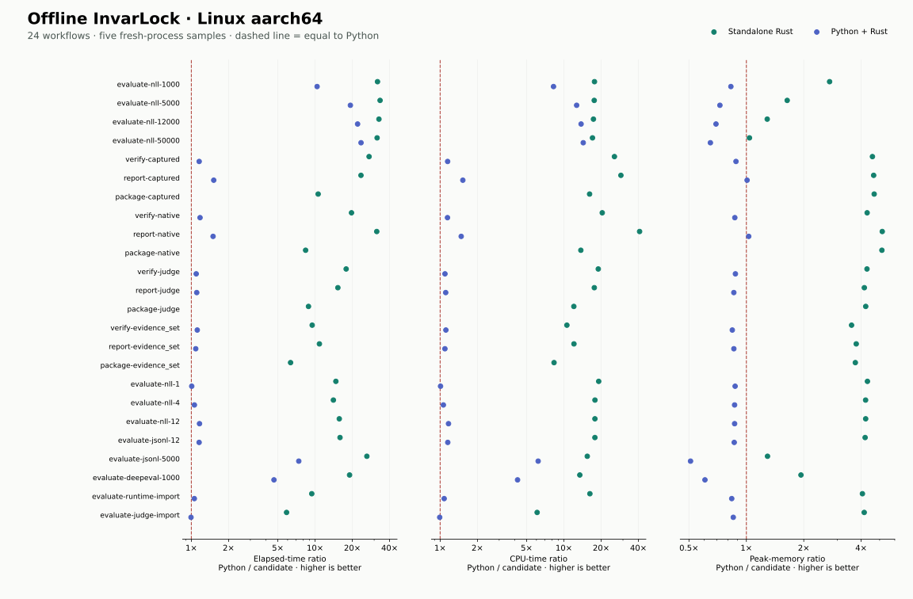
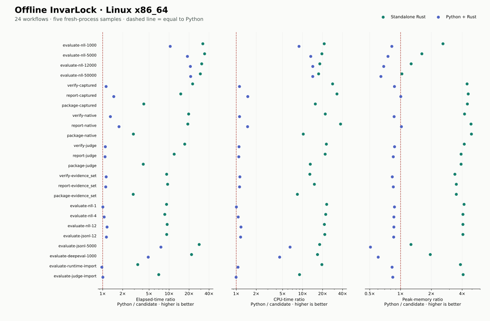

# Expanded standalone Rust comparison

Standalone Rust has lower median elapsed time, CPU time and peak RSS in all 24 measured
workflows on both Linux targets. Observed elapsed speedups range from 2.88× to 34.24×, with peak
RSS reductions from 3.0% to 80.6%. This supports the standalone offline architecture within the
measured scope; it does not imply that every Python/Rust FFI path wins.

The completed offline implementation is compared with corrected Python 0.17.3 at `staging/next`
revision `1dc9cb644684dc915810da77326f6da8764c58c1`. Standalone Rust and Python with Rust are
measured separately. The latter retains Python startup, import adapters and facade work. It
invokes the Python facade directly; the separate control-process compatibility launcher is
functionally tested but not timed here.

## Completed scope

Native offline evaluation supports all eight export adapter entry points, nineteen evaluator
profiles, retained runtime imports and retained judge imports. Verification, receipts, reports
and handoff packages cover all four evidence families. Setup, strict JSON/YAML, environment
defaults, plain terminal output and Linux binary bundles are implemented. Model SDK execution,
live judge collection and custom Python plugins use an explicitly selected compatibility worker
with bounded I/O, a deadline and process-group cancellation.

## Comparison protocol

Each Linux architecture ran 68 qualification executions followed by 340 timed executions: 24
workloads, five balanced rounds, seed 4127. Twenty workloads have all three candidates; four
handoff-package workloads have Python and standalone Rust because the Python facade does not
expose a Rust package backend. Every final execution matched. There were no retries or
exclusions within either final run.

Results are medians of five fresh processes. Elapsed time includes startup and complete command
execution; CPU is user plus system time; memory is process peak RSS. Filesystem caches are not
flushed. Rust may use bounded parallel work within the same CPU quota, so CPU time is reported
separately from elapsed time. Identity checks happen outside measured workers. Both containers
have four CPU equivalents and a 12 GiB limit. ARM64 runs in a local Docker VM; x86_64 runs in a
remote KVM environment reporting AMD EPYC 9655 processors. Ratios compare implementations within
each machine, not the machines against each other. Five samples establish observed medians, not
universal performance guarantees. No inference, GPU or live provider work is timed.

Machine JSON is compared with numeric types preserved. Deterministic files are compared by
bytes, with output locations normalized. Package generator identities correctly differ; ZIP
container metadata and compression differ, but every uncompressed member is checked against the
delivered file. Standalone commands run with no discoverable Python interpreter. Default Rich
terminal layout is outside byte parity; native reports print Markdown.

## Observed median wins

A win means a strictly lower measured median. Small differences are not claims of statistical
significance.

| Linux target | Candidate | Lower elapsed | Lower CPU | Lower peak RSS |
| --- | --- | ---: | ---: | ---: |
| aarch64 | Standalone Rust | 24/24 | 24/24 | 24/24 |
| aarch64 | Python + Rust | 19/20 | 19/20 | 2/20 |
| x86_64 | Standalone Rust | 24/24 | 24/24 | 24/24 |
| x86_64 | Python + Rust | 19/20 | 19/20 | 2/20 |

On aarch64, Python with Rust used more peak memory in 18 of 20 workloads. Its elapsed/CPU median
regressions were: `evaluate-judge-import` (elapsed +0.6%, CPU +0.8%). The complete values below
retain these outcomes; small timing differences remain subject to run variation.

On x86_64, Python with Rust used more peak memory in 18 of 20 workloads. Its elapsed/CPU median
regressions were: `evaluate-runtime-import` (elapsed +3.0%); `evaluate-judge-import` (CPU
+0.5%). The complete values below retain these outcomes; small timing differences remain subject
to run variation.

The results support using standalone Rust for offline work and retaining Python for
compatibility integrations. FFI memory overhead is not solved: the Python facade still holds
imported values and crosses conversion boundaries that the native offline path avoids. The
separate buffer diagnostic below measures one boundary, not the whole facade.

## Linux aarch64

Seconds and MiB are absolute medians. A dash means no FFI route.

| Workload | Python s | FFI s | Rust s | Python MiB | FFI MiB | Rust MiB |
| --- | ---: | ---: | ---: | ---: | ---: | ---: |
| `evaluate-nll-1000` | 3.2584 | 0.3139 | 0.1020 | 63.36 | 76.38 | 23.19 |
| `evaluate-nll-5000` | 15.3209 | 0.7943 | 0.4572 | 113.94 | 156.83 | 69.59 |
| `evaluate-nll-12000` | 36.4712 | 1.6538 | 1.1115 | 194.69 | 280.96 | 151.34 |
| `evaluate-nll-50000` | 153.6273 | 6.5345 | 4.8447 | 618.73 | 955.27 | 596.03 |
| `verify-captured` | 0.2354 | 0.2034 | 0.0086 | 52.64 | 59.67 | 11.48 |
| `report-captured` | 0.2180 | 0.1437 | 0.0093 | 52.43 | 51.96 | 11.27 |
| `package-captured` | 0.2152 | — | 0.0203 | 52.87 | — | 11.29 |
| `verify-native` | 0.2458 | 0.2090 | 0.0125 | 52.77 | 60.66 | 12.27 |
| `report-native` | 0.2212 | 0.1476 | 0.0070 | 52.31 | 50.84 | 10.14 |
| `package-native` | 0.2311 | — | 0.0276 | 52.69 | — | 10.25 |
| `verify-judge` | 0.2294 | 0.2095 | 0.0129 | 53.14 | 60.66 | 12.38 |
| `report-judge` | 0.2330 | 0.2107 | 0.0152 | 51.81 | 60.28 | 12.46 |
| `package-judge` | 0.2352 | — | 0.0266 | 52.00 | — | 12.30 |
| `verify-evidence_set` | 0.2519 | 0.2255 | 0.0266 | 53.50 | 63.40 | 15.02 |
| `report-evidence_set` | 0.2454 | 0.2260 | 0.0226 | 53.44 | 62.15 | 14.18 |
| `package-evidence_set` | 0.2522 | — | 0.0398 | 53.50 | — | 14.35 |
| `evaluate-nll-1` | 0.1991 | 0.1977 | 0.0135 | 50.55 | 57.89 | 11.71 |
| `evaluate-nll-4` | 0.2083 | 0.1968 | 0.0148 | 50.56 | 58.29 | 11.98 |
| `evaluate-nll-12` | 0.2363 | 0.2030 | 0.0151 | 50.57 | 58.28 | 11.97 |
| `evaluate-jsonl-12` | 0.2409 | 0.2084 | 0.0151 | 50.56 | 58.54 | 12.05 |
| `evaluate-jsonl-5000` | 15.7411 | 2.1325 | 0.6007 | 115.02 | 225.70 | 89.09 |
| `evaluate-deepeval-1000` | 3.6099 | 0.7756 | 0.1901 | 77.77 | 128.23 | 40.22 |
| `evaluate-runtime-import` | 0.2426 | 0.2295 | 0.0258 | 50.94 | 60.78 | 12.54 |
| `evaluate-judge-import` | 0.4668 | 0.4696 | 0.0793 | 50.94 | 59.66 | 12.27 |

## Linux x86_64

Seconds and MiB are absolute medians. A dash means no FFI route.

| Workload | Python s | FFI s | Rust s | Python MiB | FFI MiB | Rust MiB |
| --- | ---: | ---: | ---: | ---: | ---: | ---: |
| `evaluate-nll-1000` | 3.7561 | 0.3613 | 0.1166 | 63.42 | 77.19 | 24.43 |
| `evaluate-nll-5000` | 17.8035 | 0.9435 | 0.5199 | 113.46 | 150.59 | 70.25 |
| `evaluate-nll-12000` | 42.5968 | 2.0364 | 1.3755 | 193.62 | 282.91 | 152.59 |
| `evaluate-nll-50000` | 176.0031 | 8.3343 | 5.9544 | 618.12 | 961.95 | 599.56 |
| `verify-captured` | 0.2722 | 0.2419 | 0.0120 | 52.48 | 60.21 | 11.75 |
| `report-captured` | 0.2567 | 0.1747 | 0.0171 | 52.70 | 52.44 | 11.50 |
| `package-captured` | 0.2511 | — | 0.0604 | 52.71 | — | 11.72 |
| `verify-native` | 0.3227 | 0.2470 | 0.0164 | 52.73 | 60.96 | 12.50 |
| `report-native` | 0.3065 | 0.1740 | 0.0160 | 52.46 | 51.46 | 10.75 |
| `package-native` | 0.3042 | — | 0.1049 | 52.95 | — | 10.75 |
| `verify-judge` | 0.2679 | 0.2445 | 0.0156 | 53.46 | 61.20 | 12.75 |
| `report-judge` | 0.2753 | 0.2536 | 0.0231 | 51.72 | 60.93 | 13.25 |
| `package-judge` | 0.2719 | — | 0.0666 | 51.71 | — | 13.25 |
| `verify-evidence_set` | 0.2982 | 0.2642 | 0.0325 | 53.46 | 64.42 | 15.75 |
| `report-evidence_set` | 0.2912 | 0.2620 | 0.0307 | 53.47 | 62.94 | 15.25 |
| `package-evidence_set` | 0.2899 | — | 0.1006 | 53.46 | — | 15.25 |
| `evaluate-nll-1` | 0.2418 | 0.2402 | 0.0264 | 50.95 | 58.45 | 12.21 |
| `evaluate-nll-4` | 0.2557 | 0.2428 | 0.0297 | 50.71 | 58.95 | 12.46 |
| `evaluate-nll-12` | 0.2836 | 0.2437 | 0.0303 | 50.70 | 58.94 | 12.46 |
| `evaluate-jsonl-12` | 0.2856 | 0.2511 | 0.0310 | 50.71 | 59.19 | 12.47 |
| `evaluate-jsonl-5000` | 18.0091 | 2.3917 | 0.6347 | 114.00 | 224.48 | 90.21 |
| `evaluate-deepeval-1000` | 4.1255 | 0.8503 | 0.1895 | 77.98 | 128.96 | 39.97 |
| `evaluate-runtime-import` | 0.3240 | 0.3339 | 0.0961 | 50.97 | 61.68 | 13.25 |
| `evaluate-judge-import` | 0.5692 | 0.5653 | 0.0815 | 50.95 | 60.69 | 12.46 |

## Separate FFI buffer diagnostic

This synthetic canonical-JSON diagnostic isolates immutable `bytes` and mutable `bytearray`
input handling. Immutable input is borrowed; mutable input keeps an owned snapshot. Each size
has three fresh processes per candidate. The 64-byte blob uses 1,000 calls per process; larger
blobs use one. The inner clock excludes imports, input reads and the final hash; fresh-process
measurements include them. All 36 executions per architecture matched output hashes. This is not
a model of every FFI transaction.

| Target | Blob | Candidate | Fresh s | Inner s | Peak MiB |
| --- | --- | --- | ---: | ---: | ---: |
| aarch64 | 64 B × 1,000 | python | 0.02224 | 0.00243 | 16.78 |
| aarch64 | 64 B × 1,000 | immutable | 0.02092 | 0.00040 | 22.10 |
| aarch64 | 64 B × 1,000 | mutable | 0.02111 | 0.00041 | 20.60 |
| aarch64 | 1 MiB | python | 0.02632 | 0.00448 | 20.46 |
| aarch64 | 1 MiB | immutable | 0.02410 | 0.00182 | 24.80 |
| aarch64 | 1 MiB | mutable | 0.02442 | 0.00214 | 25.28 |
| aarch64 | 16 MiB | python | 0.08553 | 0.05458 | 81.11 |
| aarch64 | 16 MiB | immutable | 0.05268 | 0.02024 | 69.73 |
| aarch64 | 16 MiB | mutable | 0.05551 | 0.02342 | 102.68 |
| aarch64 | 64 MiB | python | 0.26665 | 0.20978 | 273.17 |
| aarch64 | 64 MiB | immutable | 0.12827 | 0.07287 | 212.27 |
| aarch64 | 64 MiB | mutable | 0.13775 | 0.07800 | 277.80 |
| x86_64 | 64 B × 1,000 | python | 0.02550 | 0.00301 | 16.50 |
| x86_64 | 64 B × 1,000 | immutable | 0.02370 | 0.00038 | 19.75 |
| x86_64 | 64 B × 1,000 | mutable | 0.02349 | 0.00041 | 19.75 |
| x86_64 | 1 MiB | python | 0.02712 | 0.00321 | 20.23 |
| x86_64 | 1 MiB | immutable | 0.02512 | 0.00147 | 22.50 |
| x86_64 | 1 MiB | mutable | 0.02649 | 0.00177 | 24.57 |
| x86_64 | 16 MiB | python | 0.08529 | 0.04772 | 80.23 |
| x86_64 | 16 MiB | immutable | 0.06331 | 0.02554 | 67.75 |
| x86_64 | 16 MiB | mutable | 0.07388 | 0.03170 | 99.57 |
| x86_64 | 64 MiB | python | 0.28355 | 0.21084 | 272.73 |
| x86_64 | 64 MiB | immutable | 0.17718 | 0.10283 | 211.82 |
| x86_64 | 64 MiB | mutable | 0.20997 | 0.11952 | 275.57 |

## Correctness evidence and limits

Each final Linux artifact passed 583 differential tests and 16,448 subtests. The one Linux skip
was a separate sdist archive input; the source archive's exact-byte test passed independently on
the host. The tests exercise native contracts, replay, signing, filesystem mutation checks,
public offline commands and worker cancellation. They do not establish equivalence for every
possible input.

A retained external-import corpus matched 275 accepted exports and 191 rejection outcomes, with
numeric types checked for accepted values. One test-only altered Langfuse record limit is
retained as an alternate configuration. The built-in provider identity suite covers 521
configuration cases across four providers. These are configuration cases, not 521 model
executions. The comparison also exposed and repaired a native TensorRT artifact-format binding
typo.

The corrected Python implementation is a reference, not an infallible oracle. It includes the
merged paired-overflow error-normalization fix from PR #301. The [independent reference
audit](rust-reference-audit.md) retains separate arithmetic checks and their numeric-domain
limits. Independent native parsing, mutation/rejection tests and contract checks reduce shared
blind spots; matching implementations alone cannot prove the underlying statistical or product
design universally correct. Exact malformed-input wording, simultaneous failure ordering and
rare invalid-signature behavior are not exhaustively equivalent. Native parser/report work
limits remain documented in the workspace README.

Rust workspace checks and Clippy passed. Python test, lint and type gates passed; documentation
and examples gates passed after targeted repairs. The initially failed aggregate gate was
repaired by rerunning its affected targets. Optional live evaluator SDK tests remain skipped,
and live model/provider calls, GPU execution, real OCI engines, Windows and older Linux C
library compatibility were not qualified. Package timings use small retained evidence fixtures;
large real handoff packs require separate performance evidence. No paid or live model calls were
made.

## Retained failed setup attempts

The final comparison began only after qualification. Earlier attempts remain retained: missing
binary environment variables in a host test invocation; missing HTTP test dependencies and
process utilities on Linux; oversized parametrized test names leaking into child environments;
and a custom-plugin child missing its test dependency path. Test environment and fixture repairs
were checked on both architectures. An unchanged recovery archive was copied after a failed edit
command but was not used for qualification.

The added-workload setup first pointed FFI at the baseline Python installation, which has no
Rust-backend option. A separate experimental-facade installation repaired that boundary without
changing the baseline. The next setup retained 15 matched executions before Python rejected a
synthetic DeepEval metric in the wrong shape. Correcting that fixture produced 24 matched setup
executions. These attempts are separate from the final 816 workflow executions and 72
buffer-diagnostic executions; none was discarded or counted as a successful final comparison.

## Reproduction and artifacts

The measured native source archive SHA-256 is
`80385c6dab7bf8adb0410847c2527eb5021d844f4a944fe2d1f636b712477496`. Fixture and harness repairs
followed the binary source freeze and have separate identities in each summary. The candidate
Python wheel, native extension, installed baseline files, supervisor, fixture manifest and
native executable are also individually identified.

Compact machine-readable summaries and the median CSV are in `experiments/rust/results/`. Full
attempts, output files, fixtures, binaries, wheels, setup failures and logs are retained on TB4;
archive identities are recorded in `standalone-expanded-artifacts.json`. Fixture signing keys
are synthetic and remain in the local retained evidence, not the public report. The
[installation guide](rust-native-installation.md) describes the Linux bundles and explicit
compatibility worker.
