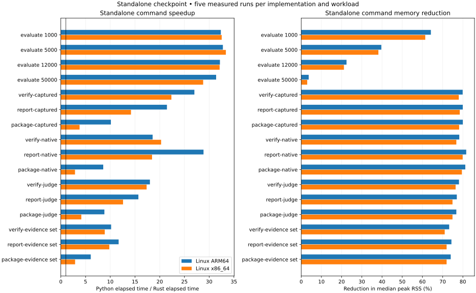

# Standalone Rust checkpoint

This is the historical 16-workload checkpoint. The
[expanded standalone comparison](rust-standalone-expanded-results.md) covers the
completed offline imports, compatibility worker, Linux bundles and separate FFI
measurements. Its final qualification also resolves the environment gates left
open at this checkpoint.

The implemented standalone workflows preserve the exercised outputs and reduce median elapsed time, CPU time and peak RSS in every measured workload on both Linux targets. This checkpoint does not complete the migration or measure Python FFI overhead.

## Scope and protocol

Reference: corrected Python 0.17.3 at `staging/next` revision `1dc9cb644684dc915810da77326f6da8764c58c1`. Each target ran 32 qualification executions followed by 160 timed executions: 16 workloads, two implementations, five balanced rounds. All 192 executions per target matched; there were no retries or exclusions within either final run. A fresh-exec supervisor measured wall time, total user/system CPU and process peak RSS. Identity checks ran outside timed processes.

Each Linux container had a four-CPU quota and a 12 GiB memory limit. ARM64 ran in a local Docker VM; x86_64 ran on the authorized remote KVM server reporting AMD EPYC 9655 processors. These are separate within-machine comparisons, not a comparison of hardware performance. Rust ran with an empty executable search path. No model, provider, network or GPU execution was timed.

JSON payloads were compared as values. Deterministic output files were compared by bytes; output paths were normalized. Package generator source identities correctly differ. ZIP compression and metadata differ, while every uncompressed member was checked against the delivered file. These are declared representation differences, not excluded failures.

## Linux ARM64

| Workload | Python seconds | Rust seconds | Speedup | Python CPU s | Rust CPU s | Python MiB | Rust MiB |
| --- | ---: | ---: | ---: | ---: | ---: | ---: | ---: |
| evaluate-nll-1000 | 3.3787 | 0.1044 | 32.36× | 3.3710 | 0.1846 | 63.32 | 22.68 |
| evaluate-nll-5000 | 15.7264 | 0.4798 | 32.78× | 15.7195 | 0.8905 | 113.99 | 68.79 |
| evaluate-nll-12000 | 38.2356 | 1.1882 | 32.18× | 38.2199 | 2.1899 | 194.40 | 150.78 |
| evaluate-nll-50000 | 156.8931 | 4.9951 | 31.41× | 156.8400 | 9.1738 | 618.42 | 595.46 |
| verify-captured | 0.2480 | 0.0092 | 27.01× | 0.2471 | 0.0094 | 52.45 | 10.54 |
| report-captured | 0.2325 | 0.0108 | 21.46× | 0.2285 | 0.0081 | 52.38 | 10.50 |
| package-captured | 0.2336 | 0.0231 | 10.12× | 0.2334 | 0.0137 | 52.68 | 10.54 |
| verify-native | 0.2707 | 0.0146 | 18.57× | 0.2590 | 0.0120 | 52.69 | 11.47 |
| report-native | 0.2476 | 0.0086 | 28.86× | 0.2356 | 0.0052 | 52.25 | 9.58 |
| package-native | 0.2485 | 0.0290 | 8.58× | 0.2397 | 0.0166 | 52.55 | 9.88 |
| verify-judge | 0.2425 | 0.0135 | 18.02× | 0.2415 | 0.0127 | 53.05 | 11.62 |
| report-judge | 0.2517 | 0.0160 | 15.69× | 0.2479 | 0.0133 | 51.75 | 11.89 |
| package-judge | 0.2509 | 0.0285 | 8.81× | 0.2508 | 0.0201 | 51.80 | 12.03 |
| verify-evidence_set | 0.2707 | 0.0266 | 10.17× | 0.2653 | 0.0234 | 53.30 | 14.27 |
| report-evidence_set | 0.2619 | 0.0224 | 11.69× | 0.2594 | 0.0202 | 53.37 | 13.69 |
| package-evidence_set | 0.2676 | 0.0442 | 6.05× | 0.2675 | 0.0321 | 53.30 | 13.86 |

## Linux x86_64

| Workload | Python seconds | Rust seconds | Speedup | Python CPU s | Rust CPU s | Python MiB | Rust MiB |
| --- | ---: | ---: | ---: | ---: | ---: | ---: | ---: |
| evaluate-nll-1000 | 3.7564 | 0.1155 | 32.54× | 3.7344 | 0.1705 | 63.25 | 24.42 |
| evaluate-nll-5000 | 17.5915 | 0.5270 | 33.38× | 17.5568 | 0.8962 | 113.05 | 69.86 |
| evaluate-nll-12000 | 42.1301 | 1.3118 | 32.12× | 42.0773 | 2.2274 | 193.38 | 152.46 |
| evaluate-nll-50000 | 175.1163 | 6.0838 | 28.78× | 174.9689 | 10.2003 | 617.76 | 599.35 |
| verify-captured | 0.2738 | 0.0122 | 22.36× | 0.2696 | 0.0097 | 52.25 | 11.50 |
| report-captured | 0.2548 | 0.0180 | 14.19× | 0.2435 | 0.0076 | 52.25 | 11.25 |
| package-captured | 0.2518 | 0.0664 | 3.79× | 0.2517 | 0.0162 | 52.50 | 11.46 |
| verify-native | 0.3295 | 0.0162 | 20.28× | 0.2734 | 0.0126 | 52.75 | 12.25 |
| report-native | 0.3063 | 0.0166 | 18.45× | 0.2446 | 0.0064 | 52.25 | 10.50 |
| package-native | 0.3153 | 0.1100 | 2.87× | 0.2545 | 0.0249 | 52.50 | 10.75 |
| verify-judge | 0.2673 | 0.0154 | 17.35× | 0.2636 | 0.0115 | 53.00 | 12.50 |
| report-judge | 0.2791 | 0.0222 | 12.58× | 0.2678 | 0.0120 | 51.75 | 13.00 |
| package-judge | 0.2725 | 0.0658 | 4.14× | 0.2724 | 0.0208 | 51.75 | 13.00 |
| verify-evidence_set | 0.2979 | 0.0335 | 8.88× | 0.2872 | 0.0224 | 53.50 | 15.50 |
| report-evidence_set | 0.2910 | 0.0297 | 9.80× | 0.2793 | 0.0186 | 53.50 | 15.00 |
| package-evidence_set | 0.2868 | 0.0994 | 2.88× | 0.2867 | 0.0346 | 53.50 | 15.00 |

## Qualification, repairs and limitations

Both final Linux artifacts passed 143 native checks and 53 standalone parity checks. The latter exercised signed/unsigned captured evaluation, preflight, all-family verification/receipts/reporting/packages, setup, key interoperability and strict request parsing. Fixtures establish their exercised behavior, not all-input equivalence.

The first complete ARM64 run exposed 720.93 MiB Rust peak RSS versus 618.59 MiB Python for 50,000
records. Moving run values into the prepared result removed a duplicate JSON tree. Its original 192
outcomes remain retained. Remote qualification also exposed same-size content mutation that metadata
timestamps missed. Pinned-file and snapshot checks now bind content digests; GGUF parsing hashes its
own complete input stream. A local intermediate run was stopped when these shared defects were
discovered. Its partial outcomes and all failed qualification logs remain retained.

The host differential attempt passed 505 tests and 16,448 subtests, skipped one unsupported filename
case, and failed one OCI test fixture that cancelled before its container identity was ready. Six
focused readiness/incomplete-identity cases passed after repair. A Rust timeout fixture was also
repaired and passed separately. These two test-only changes followed the measured source freeze;
they did not change the measured offline executable. The broader repository gate remains unresolved
because its installed Python environment lacks required type stubs and a Transformers class.

External-format imports, runtime-import orchestration, full terminal/environment/error compatibility, explicit compatibility workers and native release packaging remain outside this checkpoint. FFI overhead, large real handoff packs, GGUF read overhead and live provider execution need separate evidence.

## Retained identities

Measured source archive SHA-256: `c5b725d14623bccc15e0c4d7438e9a525d2fcd43931bbd2f4a0280975ce78223`. Full outputs, fixtures, binaries and logs are retained on TB4. Compact summaries and all installed reference-file hashes are in `experiments/rust/results/standalone-aarch64.json` and `experiments/rust/results/standalone-x86_64.json`. Earlier FFI ratios used a different timing boundary and must not be compared as if this were the same experiment.
